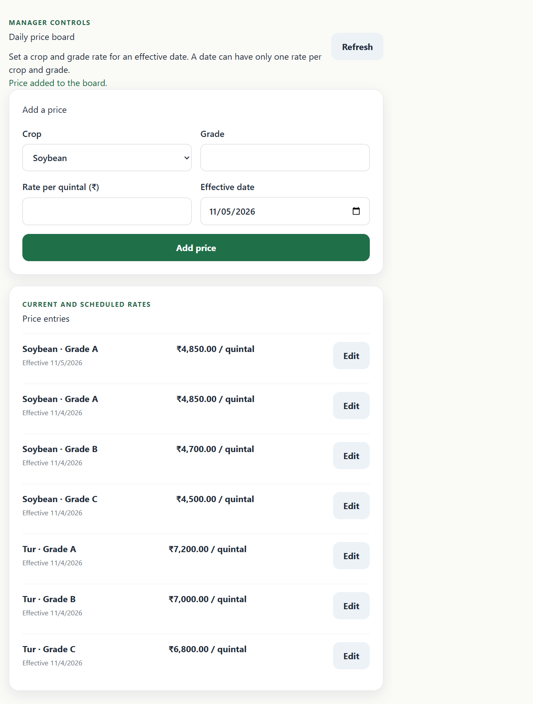
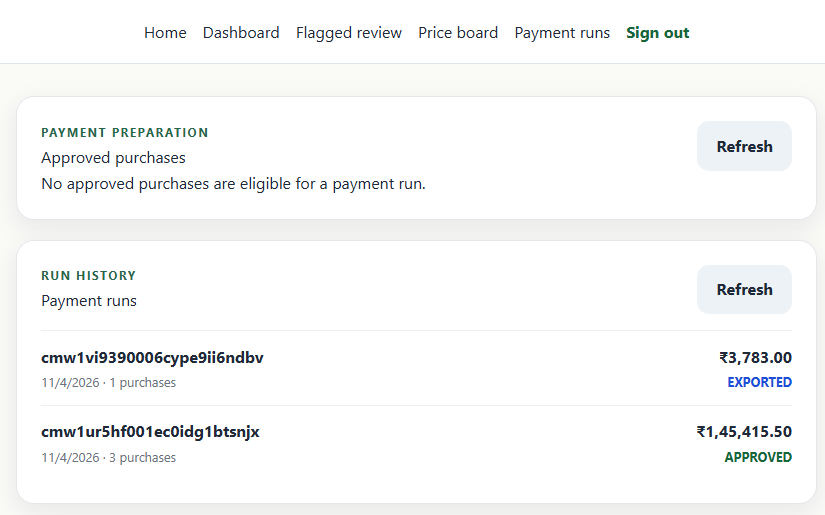

# Farmers Payment App

Offline-first procurement and payment MVP for a farmer producer company in Maharashtra.

## Tech stack

- Backend: Express, TypeScript, Prisma, PostgreSQL
- Frontend: React, Vite, TypeScript
- Offline sync: Dexie, IndexedDB, HMAC-SHA256 device signatures
- OCR: OCR.space provider with a mock provider for local testing
- Authentication: JWT access and refresh tokens

## Quick start

Prerequisites: Node.js 20+, npm, and Docker Desktop with Docker Compose.

1. Start PostgreSQL:
   ```powershell
   docker compose up -d postgres
   ```
2. Create `backend\.env` from `backend\.env.example` if it does not exist, then set the required local environment variables. Do not commit `.env` files.
3. Install dependencies:
   ```powershell
   npm run install:all
   ```
4. Apply migrations and load demo data:
   ```powershell
   npm run migrate
   npm run seed
   ```
5. Start both applications:
   ```powershell
   npm run dev
   ```
6. Open the frontend at `http://localhost:5173`. The API listens on `http://localhost:5000`.

PostgreSQL is published on port 5433 to avoid conflicts with a local PostgreSQL service on port 5432. See [docs/deployment.md](docs/deployment.md) for environment variable names and more detail.

## Demo credentials

- Operator: `operator@demo.in` / `demo123`
- Manager: `manager@demo.in` / `demo123`

## Screenshots

Screens captured from the local app:





## Main workflows

- Operators find a farmer, record a purchase, and preview the Marathi SMS slip.
- Non-flagged purchases are approved automatically; flagged purchases are held for manager review.
- Purchases can be queued offline and synced when connectivity returns.
- Managers review flagged purchases and manage payment-run approval/export.
- A payment run can be exported only once.

## Validation

Run backend tests and typechecks with:

```powershell
cd backend
npm test -- --run
cd ..
npm run typecheck
```

See [docs/TEST_REPORT.md](docs/TEST_REPORT.md) for the current audit, including known UI gaps.
