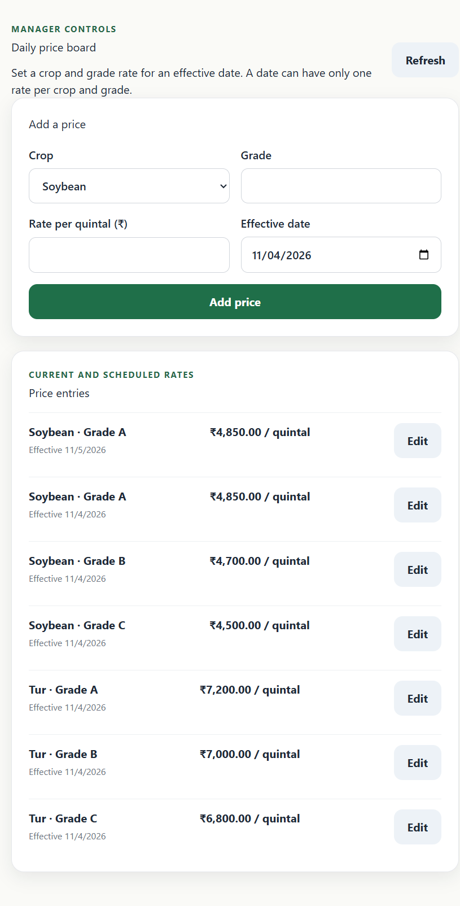
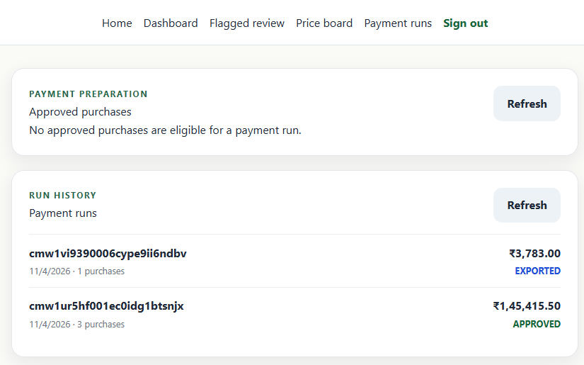

Repository URL: https://github.com/architjoke/fpc-procurement-app
Live app URL: local only, not deployed; run locally via Docker Compose + Vite + Express.

# Farmers Payment App — Technical Design Document

## 1) Architecture

The app is split into a plain Express + TypeScript backend and a Vite + React frontend with Dexie-backed offline queueing for operator devices. The backend persists to PostgreSQL via Prisma and exposes a JSON API consumed by the frontend. The project follows a single-centre operator model for procurement and a manager workflow for the dashboard, daily price board, flagged-purchase review, and payment-run export.

```text
+---------------------+         +------------------------+
| Browser / Operator  | <----> | React + Vite frontend  |
| 360px mobile flow   |         | TypeScript / Dexie     |
+----------+----------+         +-----------+------------+
           |                                  |
           | HTTP(S) / JSON API              | IndexedDB queue
           v                                  v
+---------------------+         +------------------------+
| Express API         | <----> | PostgreSQL (Prisma)    |
| JWT auth + routes   |         | centres / farmers /    |
| OCR / sync / runs   |         | purchases / payment     |
+---------------------+         | runs / audit trail     |
                                +------------------------+
```

### Why this architecture

- A React/Vite browser client supports the operator and manager screens without requiring separate applications.
- The Express API centralizes authentication, role and centre scoping, business rules, OCR parsing, sync validation, and payment-run transitions.
- PostgreSQL stores related procurement, price, review, payment, and audit records; Prisma provides the schema and migration workflow.
- Dexie keeps queued purchase data in the browser so operators can capture purchases without a network connection.
- The OCR provider boundary supports the configured OCR.space service and a mock provider for local testing.

## 2) UI and design decisions

- **Operator flow:** Find Farmer, a step-by-step purchase wizard, and purchase confirmation/SMS preview keep the collection workflow focused on one task at a time. The wizard is designed for a 360-pixel mobile viewport and surfaces the calculated purchase values for confirmation.
- **Visual hierarchy:** The requested warm off-white base (`#FAFAF7`), dark green accent (`#1B5E20`), amber flagged state (`#F59E0B`), and large numeric values distinguish routine actions and important weights or amounts.
- **Manager screens:** Dashboard summarizes activity; Price Board supports rate management; Flagged Review gives exceptions a dedicated review flow; Payment Runs groups approval and export history. These screens map to the manager tasks in the brief.
- **Login:** The login page uses a lazily loaded Three.js background so the visual treatment does not need to load with the rest of the app.
- **Feedback and resilience:** Loading, empty, and error messages communicate screen state; the offline/sync indicator makes queued work visible rather than implying it has already synchronized.

Representative manager screens from the local application:





## 3) Data model summary

- centres
- farmers
- crops
- price_board
- purchases
- device_sessions
- sync_nonces
- payment_runs
- payment_run_items
- sync_log
- audit_trail
- sms_outbox
- ocr_jobs

## 4) API contract

- `POST /api/v1/auth/login`
- `POST /api/v1/auth/refresh`
- `POST /api/v1/auth/logout`
- `GET /api/v1/farmers`
- `POST /api/v1/farmers`
- `GET /api/v1/farmers/:id`
- `PUT /api/v1/farmers/:id`
- `GET /api/v1/price-board`
- `POST /api/v1/price-board`
- `PUT /api/v1/price-board/:id`
- `GET /api/v1/purchases`
- `POST /api/v1/purchases`
- `PATCH /api/v1/purchases/:id/review`
- `POST /api/v1/ocr/parse`
- `POST /api/v1/sync/purchases`
- `POST /api/v1/payment-runs`
- `GET /api/v1/payment-runs`
- `GET /api/v1/payment-runs/:id`
- `PATCH /api/v1/payment-runs/:id/approve`
- `GET /api/v1/payment-runs/:id/export`
- `GET /api/v1/sms/:purchaseId`
- `GET /api/v1/dashboard/summary`

## 5) Business rules contract

- Net weight = `gross - tare`.
- Moisture deduction applies to full percentage points above 12%.
- Net weight is rounded to one decimal place before pricing.
- Amount is calculated in integer paise; no float storage.
- Price board is per crop/grade/effectiveDate with one valid price per day.
- Tare cannot exceed gross.
- Purchases without anomaly flags are automatically marked `APPROVED` and become eligible for payment runs; flagged purchases are held for manager review.
- Flagged purchases require manager review and audit logging.
- Payment runs move through `DRAFT -> APPROVED -> EXPORTED`.
- A payment run cannot be exported twice.

### Anomaly review rules

| Trigger             | Rule                                                                                                   | Handling                                                  |
| ------------------- | ------------------------------------------------------------------------------------------------------ | --------------------------------------------------------- |
| `YIELD_CAP`         | Net weight exceeds 1,500 kg/acre for soybean or 1,000 kg/acre for tur; equality at the cap is allowed. | Persist as `FLAGGED` and include the limit in the reason. |
| `REPEATED_FARMER`   | Same farmer has a purchase in the previous 60 minutes.                                                 | Persist as `FLAGGED`; do not cancel or overwrite.         |
| `MOISTURE_VARIANCE` | At least five same-centre/day readings vary by less than 0.5 percentage points.                        | Persist as `FLAGGED`; exact 0.5 does not trigger.         |

**ASSUMPTION — Anomaly date handling:** Moisture comparisons use UTC calendar days and use the purchase device timestamp when present; older purchases without a device timestamp fall back to creation time. Managers must provide a reason when approving or rejecting a flagged purchase. Approval changes `FLAGGED` to `APPROVED`; rejection changes it to `REJECTED`.

## 6) OCR flow

```text
Operator uploads image -> multer validation -> provider factory -> raw text parse -> parseOcrText()
        -> p95/low-confidence check -> OcrJob row persisted -> purchase creation validates OCR mismatch
```

Notes:

- Uploads accept JPEG, PNG, GIF, and WebP with max size 1 MiB.
- `OCR_PROVIDER=mock` switches to the in-memory mock provider; production uses OCR.space.
- Parsed values are stored in `ocr_jobs`, including raw text, confidence, and `purchase_id` once linked.
- If the operator enters values that differ from OCR without explicit reconciliation, creation fails with `OCR_MISMATCH`.

## 7) Offline sync sequence diagram

```text
Operator -> Frontend Dexie: queue purchase payload
Frontend -> Frontend: sign payload with HMAC device secret
Frontend -> API: POST /api/v1/sync/purchases
API -> API: verify HMAC + device session + nonce + timestamp ordering
API -> DB: create purchase as APPROVED / mark FLAGGED if conflict found
API -> SyncLog: ACCEPTED or REJECTED with reason
API -> Frontend: accepted rejected results
Frontend -> Dexie: remove accepted rows; keep retryable queue entries for rejected/transient failures
```

### Retry policy choice

**ASSUMPTION — Retry policy:** Failed sync entries stay `QUEUED` with `lastError` preserved unless the failure is a permanent validation issue that the backend can never recover from. This preserves the TDD contract and prevents silent data loss while waiting for connectivity or a later resubmission.

## 8) Marathi SMS slip contract

The exact template is:

`रसीद {slip_no} | शेतकरी: {farmer_name} | {crop_name} | सकल वजन: {gross_kg} किलो | कच्चा वजन: {tare_kg} किलो | ओलावा: {moisture_pct}% | शुद्ध वजन: {net_kg} किलो | दर: ₹{rate}/क्विंटल | रक्कम: ₹{amount} | केंद्र: {centre_code}`

The mock SMS gateway stores exactly one log row per non-flagged purchase in `sms_outbox` using the unique `purchase_id` constraint. `GET /api/v1/sms/:purchaseId` returns the stored slip preview for the operator’s centre. Flagged purchases do not produce slips; approval does not retroactively send one.

## 9) Assumptions and constraints

All interpretations not directly specified in the brief are labeled **ASSUMPTION** below. Technology and implementation descriptions elsewhere in this document describe the current project, not additional client requirements.

- **ASSUMPTION — Kamal Shinde rounding ambiguity:** Net weight is rounded to one decimal place after moisture deduction using `Math.round(value * 10) / 10`, consistent with the canonical test case.
- **ASSUMPTION — Purchase approval:** Non-flagged purchases are automatically approved; flagged purchases require a manager decision.
- **ASSUMPTION — SMS timing for flagged purchases:** Flagged purchases do not generate slips, and approval does not send one retroactively.
- **ASSUMPTION — Device secret lifecycle:** Device keys are temporary secrets returned at login; only the SHA-256 hash is stored on the server.
- **ASSUMPTION — Price effective-date interpretation:** The API treats a crop/grade/effective-date combination as unique and rejects a duplicate for that date.
- **CONSTRAINT — Farmer privacy:** No Aadhaar field is included in the schema or app contract.

## 10) What we cut

The MVP intentionally excludes deeper operational features not needed for the client brief, including:

- truck dispatch or logistics management
- multi-warehouse stock dashboards
- advanced analytics beyond the daily summary dashboard
- deep procurement forecasting or external bank integration beyond a mock CSV export

## 11) What we'd build next

- full farmer/member onboarding workflow with consent capture audit history
- end-to-end mobile app packaging with real OCR provider and push/pull sync service
- deeper audit dashboards and exception management beyond the current manager summary and flag review
- production-grade bank integration and reconciliation exports
